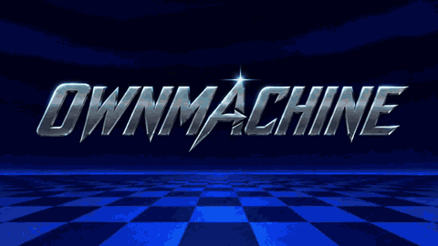
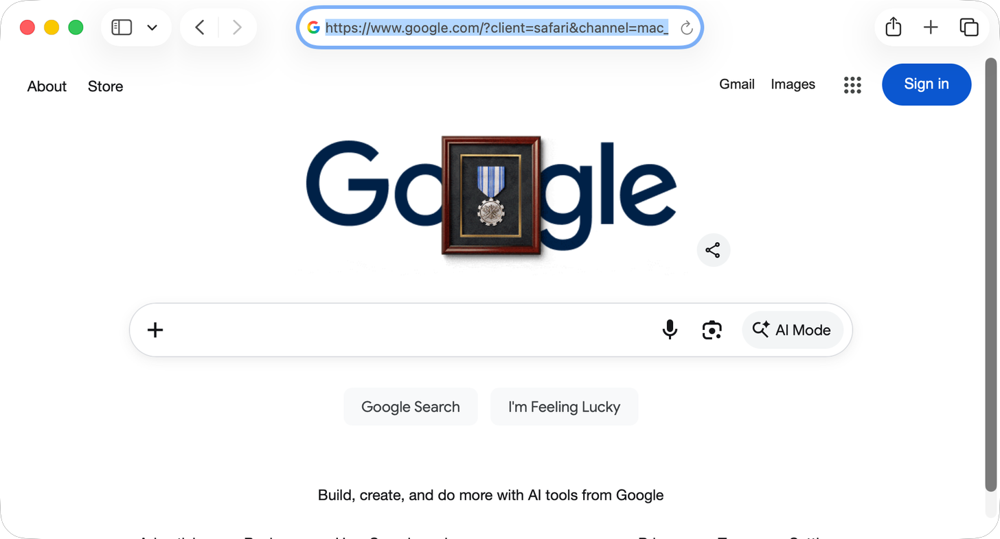

# OwnMachine

### Give your AI agent its own desktop.

**A persistent desktop for Hermes—with private SSH access and a browser viewer that keeps you in control.**

You want an agent that can use desktop apps. You don't want to hand it your
personal desktop, give up your mouse while it works, or spend a weekend wiring
together a VM, remote desktop, screen capture and automation scripts.

OwnMachine gives Hermes a separate macOS or ARM64 Omarchy virtual machine: its own apps, files
and working environment. You decide what goes into that workspace. Watch it in
your browser, pause the agent, take over with your mouse and keyboard, then hand
control back when you're ready.

[](https://raw.githubusercontent.com/rbur0425/ownmachine/v0.8.0/docs/media/ownmachine-teaser.mp4)

**[Download the 15-second teaser with sound (MP4)](https://raw.githubusercontent.com/rbur0425/ownmachine/v0.8.0/docs/media/ownmachine-teaser.mp4)** · Stylized introduction, not a live automation benchmark.

> **v0.8.0 preview — free for permitted noncommercial use; commercial licensing available.** OwnMachine is a community plugin for Hermes, not an
> official Nous Research product. Setup includes administrator firewall installation
> and manual macOS permission grants. It is not yet listed in the Hermes catalog.

> **v1.0.0 candidate — unreleased PR #15:** Omarchy foreground desktop support on Apple Silicon has passed fresh installation and real-model acceptance. macOS remains the default. Background Omarchy control remains experimental; see the [tested scope and final evidence](docs/omarchy-final-acceptance.md). The v0.8.0 downloads below do not include Omarchy.

## A verified desktop task

Hermes, using a local Qwen model and the installed OwnMachine plugin, cold-launched
Safari and opened Google. A separate screenshot and accessibility URL read
confirmed completion; no operator input was supplied during the model run.



See the [passing run and initial failure/fix](docs/docker-reminder-acceptance.md#fixed-cold-launch-rerun--passed).
This demonstrates one keyboard/accessibility task, not a general benchmark.

## Your desktop stays yours

Desktop work doesn't always have an API. Sometimes the task is inside a native
app, a file dialog or a workflow spanning several applications. OwnMachine brings
Hermes's native `computer_use` tool into a dedicated macOS guest so those actions
happen in the agent's workspace, rather than on your everyday desktop.

- **Keep personal work separate.** Put only the files, apps and accounts the agent
  needs in its VM. Its guest permissions don't grant control of your host desktop.
- **Stay in control.** Live noVNC viewing lets you see the workspace. Reserve it
  for human use to click and type directly; return it to the agent when finished.
  One shared control gate coordinates both, and failed or uncertain writes stop
  further input until an operator reviews them.
- **Keep the workspace between sessions.** Installed apps and saved files stay
  on the VM disk. You can start, restart and shut down the VM from the viewer.
- **Spend less time connecting separate tools.** OwnMachine supplies the Hermes
  provider, restricted SSH relay, VM setup scripts, guided permissions, browser
  viewer and actionable doctor checks in one project.
- **Choose your model through Hermes.** OwnMachine doesn't require a particular
  model vendor. Desktop-task reliability still depends on the model, instructions
  and application; vision tasks need a compatible model configuration.

## Private connections, explicit access

Hermes connects to your Mac host through **SSH with a dedicated restricted key**.
The host relay allows only OwnMachine's supported operations for the configured
VM and rejects arbitrary shell commands. A separate verified SSH connection
reaches the guest's computer-use driver. Browser desktop traffic is relayed over
SSH, with the host firewall blocking direct network access to the VNC port.

```text
Hermes + OwnMachine ── restricted SSH ──▶ Mac host ── guest SSH / MCP ──▶ macOS VM
Private browser viewer ── SSH-backed VNC relay ────────────────────────▶ same VM
                          shared human / agent control gate
```

This is an outbound connection from the Hermes runtime to the Mac's normal SSH
endpoint, **not a required reverse SSH tunnel**. When the viewer runs remotely,
you reach its loopback-only web interface through a separate SSH port forward.
The viewer uses a private access link; restarting it rotates that credential.
Never expose the viewer or VNC port directly to the public internet.

**Self-hosted does not automatically mean all data stays local.** The desktop
runs on your Mac hardware, but Hermes may send screenshots and app text to your
configured model provider. Choose the model deployment and guest contents for
your privacy needs. The VM is a separate workspace, not a guarantee against a
compromised host or malicious software. Read the [security model](SECURITY.md).

## Where it runs

| Component | Deployment |
| --- | --- |
| macOS desktop | A Lume VM on a compatible Apple Silicon Mac. Local laptop and dedicated Mac-host installations have been tested. |
| Omarchy desktop (unreleased) | ARM64 guest on Apple Silicon with patched Lume; tested foreground Chromium and Mousepad control. The native input module requires explicit opt-in and a matching Hyprland ABI. |
| Hermes | On the same Mac or another machine with private SSH access to the host. A separate Linux Docker runtime has been tested. |
| Browser viewer | On a configured runtime host, reached locally or over SSH forwarding. Human input requires a reservation. |
| Cloud Mac | Potentially suitable if it supports Lume's virtualization requirements and private SSH connectivity. Cloud-hosted Macs have not been acceptance-tested. |

A generic Linux or Windows cloud server can host Hermes; it does not replace the
Apple Silicon Mac needed for the macOS guest.

## Get started

**Start with the [evaluator quickstart](docs/evaluator-quickstart.md).** It covers administrator
handoffs, separate runtime identities, shared-control permissions and a verified
Safari-to-Google task. The detailed guides below remain available for each stage.

Download the checksummed full-source bundle from the
[v0.8.0 release](https://github.com/rbur0425/ownmachine/releases/tag/v0.8.0)
and [verify it before extraction](docs/distribution.md). It includes the setup
scripts and browser viewer; the plugin-only bundle does not.

You'll need Hermes **0.23.1 or later** (tested on 0.23.1), Python and OpenSSH,
plus a compatible Apple Silicon Mac running macOS 13 or later. The default guest
uses **4 CPUs, 8 GiB RAM, a 64 GiB sparse disk and a 1900×1200 display**. The
provisioner uses a configurable 60 GiB free-space preflight budget; restore
images, caches and guest growth need headroom. See [storage and VM setup](docs/vm-setup.md).

```sh
git clone https://github.com/rbur0425/ownmachine.git
cd ownmachine
git checkout v0.8.0
```

Follow the setup in order. Installing the Hermes package alone does not create
or secure a VM.

1. **Prepare the Mac connection.** [Install Lume and the restricted host relay](docs/host-setup.md),
   configure your SSH alias and verify its host key.
2. **Create the guest.** Follow [VM provisioning and first boot](docs/vm-setup.md)
   and [native provider / MCP setup](docs/native-provider.md). Approve Accessibility,
   Screen Recording and the capture check **inside the guest**. No Apple account
   is required by the tested workflow.
3. **Connect Hermes.** Use the [dedicated-home installer](docs/community-setup.md)
   and configure your model in that home. Existing Hermes homes have a separate
   manual configuration path; the installer won't overwrite them.
4. **Add browser control.** Complete the [noVNC onboarding and firewall steps](docs/community-setup.md#set-up-the-novnc-browser-desktop),
   then retrieve your [private viewer link](docs/viewer-access.md).
5. **Check readiness.** Run `hermes computer-use doctor` in the configured Hermes
   home, or use the [combined onboarding check](docs/onboarding-check.md).

Use your own hostnames, accounts, paths and ports. Keep credentials and runtime
configuration outside the source checkout. Every agent and viewer for one VM
must share the same underlying control directory.

## Daily use

Open the private viewer to watch the desktop. **Pause agent** stops new agent
input. **Reserve for human use** gives you direct browser mouse and keyboard
control. **Return to agent** hands the workspace back and requires a fresh capture.
A handoff waits for active input; it cannot undo an action already sent.

The viewer also provides **Start VM**, **Restart VM** and **Shut down VM**.
Save guest work before restarting or shutting down. After a host reboot, login
or FileVault unlock and explicit guest startup may be required. Verify the host
firewall before starting the VM; do not disable FileVault.

See [persistent installation and startup](docs/permanent-installation.md),
[recovery](docs/recovery.md) and [offline plugin upgrades](docs/upgrading.md).

## Roadmap

1. Broaden ARM64 Omarchy application compatibility beyond the tested foreground configuration ([plan and evidence](docs/omarchy-plan.md)).
2. Implement an Ubuntu image.
3. Implement a Windows VM.
4. Test various cloud providers and record tutorials and setup guides for each.

## Contributing

Noncommercial modifications and redistribution are permitted under the license,
subject to its terms and notices. Commercial use outside its permissions requires
a separate license. Feature contributions use pull requests into `develop`;
releases use a `release/*` PR
into `main`, followed by a tag and synchronization back into `develop`. See
[contribution rules](AGENTS.md), [validation](docs/ci.md) and
[verified distribution bundles](docs/distribution.md). Only `plugin/` is the
installable Hermes package; host scripts and the viewer stay outside it.

## License and credits

The [PolyForm Noncommercial License 1.0.0](LICENSE) permits use, modification
and redistribution for its permitted noncommercial purposes, subject to its
terms and notice requirements. It also expressly permits use by the organizations
listed in its Noncommercial Organizations section. Commercial use outside those
permissions requires a separate license from [Roland Burke](https://github.com/rbur0425).

OwnMachine is source-available, not open source. Third-party components retain
their own terms. Earlier valid license grants are not revoked. See
[licensing details](docs/licensing.md).

OwnMachine builds on Hermes, Lume, CuaDriver and noVNC. Third-party components
retain their own licenses and notices; this license does not replace them.
See [viewer dependency provenance](viewer/VENDOR.md).
