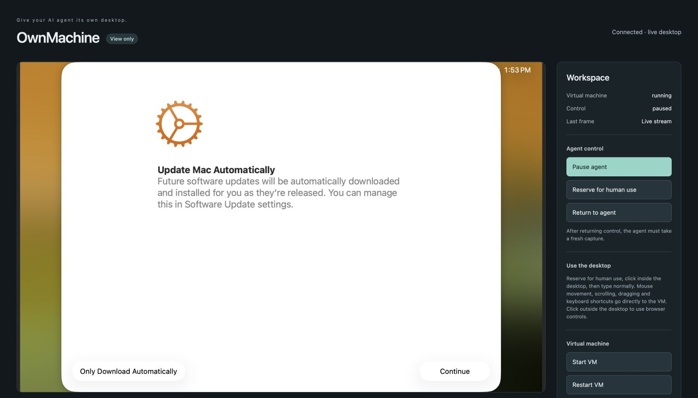

# macOS relay cold-start acceptance

Verified November 12, 2026, on a newly prepared Apple M3 Ultra Mac Studio
(96 GiB RAM, macOS 26.6.2). This closes the live macOS normal-start coverage gap
for the common VNC credential-export removal patch. A subsequent run completed
guest onboarding and CuaDriver consent, then verified a real Hermes Safari task
with one operator-reviewed recovery (details below). No physical-host reboot was
performed on this new host.

## Build and preparation

The installed source was PR #15 commit
`142888a` (full identity is available in the PR history). The macOS-only Lume build
used upstream `666c196f42dc9c83dbe075e20318f16c3e3a6d84` with the common clipboard,
password-file and no-guest-VNC-credentials patches; **no Linux isolation patch**.
Revision, complete patch inventory, local signature and protected CLI checks passed.
The actual deployed executable SHA-256 was
`02cdf0f756302cf3e6d7d377437303a573fa849e5a0c1c09d6c1b5e2f506cbc2`.
Both normal and USB/recovery Swift configuration regression tests also passed on
this separately built source. USB/recovery hardware boot was not exercised.

The administrator created a non-admin host account, initialized its graphical
login and installed required PF/application-firewall protection. At the owner's
request this account may also run existing automations: **it is not an exclusive
OwnMachine OS-account isolation boundary against those automations**. OwnMachine
uses private files and distinct restricted SSH keys; account-wide SSH policy was
not changed to disrupt unrelated automation. Addresses, account names, keys and
runtime paths remain operator configuration outside the repository.

A fresh macOS 26.6.2 guest was provisioned with 4 CPUs, 8 GiB RAM, a 64 GiB sparse
disk and 1900×1200 display. Installer verification VNC was disabled. Provisioning
returned exit 0 and a `created` receipt. The normal hardening stage passed:
key-only guest SSH, password rotation, password-SSH refusal, aligned login keychain
and the restricted guest shutdown helper. No existing VM was overwritten.

## Actual relay cold start

1. The viewer-role relay gracefully stopped the hardening boot. The lifecycle
   result was `stopped`, with agent control paused.
2. Independent Lume metadata reported `savedState: false`; neither `state.vzvmsave`
   nor `state.vsock` existed. This was a shutdown, not suspend/resume.
3. The **viewer-role relay** started the guest using the deployed macOS build,
   protected password file and required firewall. The lifecycle result was
   `running`, with agent control still paused.
4. Independently pinned guest SSH reported a **different boot time**, macOS 26.6.2
   and a running WindowServer. No guest `.vnc.env`, `/Volumes/lume-config` or
   VirtioFS mount existed.
5. Host checks passed: required firewall attestation, private VNC password/log
   modes 0600 and no VNC password in process arguments. Direct host VNC from
   the laptop timed out. The agent key refused VNC; the viewer key refused MCP.
6. The normal authenticated noVNC viewer showed the live fresh guest's
   **Update Mac Automatically** first-run screen. Viewer doctor passed private
   HTTP authentication, noVNC assets/dependency, live browser-stream presence
   and shared VNC authentication. Intentional paused-control and independently
   tested external-firewall warnings remain visible.

## Diagnostic failure retained

An additional operator-written raw-only RFB framebuffer probe was not compatible
with this Lume/Apple VNC server. It negotiated authentication but advertised only
raw encoding. Lume logged an unsupported-pseudo-encoding diagnostic and exited;
its stream returned an error. This was **not** counted as a passing viewer test.
The private diagnostic log was preserved, and no input was sent or replayed.

A fresh relay start recovered the guest. The product's normal noVNC client then
connected and displayed the first-run screen; a separate shared-handshake probe
also passed while that browser stream remained active. Guest boot time,
`savedState: false` and credential-share absence were rechecked. Generic/raw-only
VNC clients are not certified; keep using OwnMachine's reviewed noVNC path.
This evidence does not claim that the upstream server handles every RFB client
robustly. The initial viewer launch also lacked its separate Python dependency;
installing the documented pinned `viewer/requirements.txt` into a dedicated viewer
venv corrected the operator harness before the passing normal-client checks.

## Cleanup and scope

Both temporary unrestricted setup authorizations were removed by exact public-key
identity, preserving other entries. Subsequent authentication with each retired
key was rejected; the restricted runtime agent key still returned running-VM
status. The viewer remains authenticated and the workspace paused.

## Follow-up: guest onboarding and Docker-to-Studio Hermes task

The same fresh guest reached Finder after the owner completed its remaining
first-run choices. The normal setup-services driver stage installed the signed,
pinned **macOS CuaDriver 0.44.0** and the normal permission guide; no TCC database
edits or permission bypasses were used. With explicit owner approval, the operator
enabled Accessibility, added CuaDriver to Screen Recording, selected Quit & Reopen,
and approved the guide's final screen-capture prompt. The guest's existing password
worked through the noVNC viewer. The permissions stage then returned `checks_passed`;
runtime status independently reported all three consent flags and `driver_ready`
true. The host desktop received no permissions.

### Installed plugin and control boundary

A fresh Hermes Docker profile installed `plugin/` through Hermes's supported Git
URL installation route at immutable commit
`0cc76c45d544347727b5e378fab64dfba04f129f`. The host runtime source remained
`142888a` (the intervening commits only changed documentation). The harness used
Hermes checkout `b5f15a6` and the configured local model
`qwen3.8-flash-next-iq2_xs`; no provider credential was copied. Terminal, file and
code-execution toolsets were disabled, and the task used `computer_use` only.

Separate agent/viewer OS users and containers owned separate restricted SSH keys.
Both used the same shared control directory; actual-user SQLite transaction and
session-lock checks passed. The viewer token stayed in its private viewer-owned
directory. The earlier local viewer was stopped before the model run so it could
not operate through a different control database. The profile's noninteractive
action approvals were enabled only for this authorized test, then restored to deny.

### Real task, retained failure, and recovery

The requested task was to **open Safari and navigate to https://www.google.com/**.
Safari was initially not running. The first model run made 19 computer_use calls:
it captured the desktop, launched Safari in the background, handled its welcome
card and focused its address field. Raw background typing was refused by the
upstream driver with `minimized_or_hidden_window`. OwnMachine latched the uncertain
operation, and the model stopped rather than retrying writes. The operator
independently inspected the empty URL field and acknowledged the pending operation.

The same Hermes session resumed with explicit guidance to use Accessibility field
controls. In eight further computer_use calls, the model set the smart-search
field's AXValue to the URL. An attempted AXPress on a field without that action was
refused without dispatching input. The model then used the normal approved
**foreground Return** path and captured the resulting Google page.

Independent verification in the authenticated browser viewer showed Safari's
`google.com` address and the rendered Google homepage. The operator did not open
Safari, type its URL, press Return or otherwise perform the task for the model.
Both model transcripts are retained privately; the public screenshot contains
only this fresh test desktop. The workspace was left paused with Safari on Google.

This is a **real model task completed after operator-reviewed recovery**, not an
uninterrupted autonomous or background-only acceptance pass. Two additional limits
were observed: bundle-ID capture did not resolve window records lacking bundle IDs
(the model recovered using display name or explicit PID/window ID), and the viewer
occasionally retained a stale frame during consent transitions (reloading refreshed
it). These are retained findings, not evidence that every GUI path is reliable.

### Temporary access cleanup

Only the dedicated-account setup key was temporarily restored for this follow-up;
the administrator setup key stayed retired. Cleanup found two identical restored
entries, removed both by exact public-key identity while preserving all other
keys, and verified that authentication with that key was rejected. The restricted
runtime key still reported the guest and driver ready afterward. Credentials,
private addresses, operator account names and machine-specific paths are not part
of the repository or public evidence.

The mandatory rebuild, graceful shutdown, no-saved-state and relay cold-start
instructions remain in the [release candidate notes](release-0.8.0.md). This test
is evidence for review, not authorization to merge, tag, publish or change the
catalog pin.
