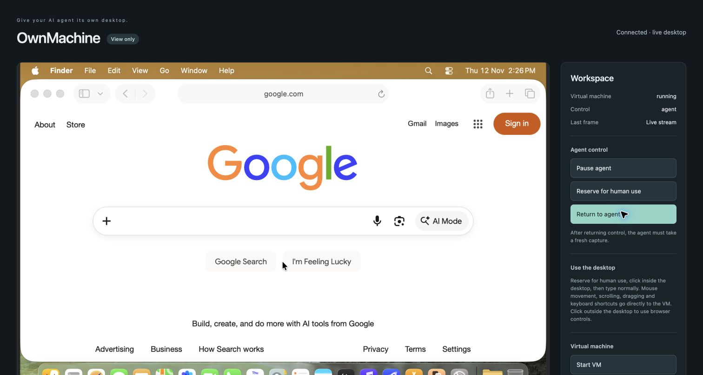

# macOS cold-start and model acceptance

2026-11-12; host source `142888a`, installed-plugin follow-up `0cc76c45d544347727b5e378fab64dfba04f129f`.

A fresh Apple Silicon macOS guest passed provisioning, hardening and a genuine
relay cold start on the common-patch Lume build. No old saved state was resumed.
Credential exports were absent, host secret/log permissions passed, direct LAN
VNC was blocked and opposite-role operations were refused. Normal noVNC streaming
passed. USB/recovery paths had Swift regression coverage, not a hardware boot.

An extra raw-only diagnostic VNC client caused an upstream server exit; a relay
cold start recovered and normal noVNC passed. Generic VNC clients are not certified.
No physical-host reboot was performed. The host account was not exclusive to
OwnMachine, so isolation from other code under that account is not claimed.

## Follow-up: guest onboarding and Docker-to-Studio Hermes task

Manual first-run choices, signed macOS driver installation, both guest permissions
and final capture consent passed. A fresh Docker profile used separate runtime
identities, shared control and computer_use without host execution tools.

Hermes opened Safari and reached Google after one operator-reviewed recovery from
a refused background write. Independent viewer inspection confirmed the URL and
page; the operator did not navigate. This was not an uninterrupted or background-
only pass. Capture target resolution and stale consent-transition frames sometimes
needed a different target or viewer reload.

Temporary setup access was retired and rejection verified; runtime access remained.
The later output-redaction patch was not redeployed on this host; its macOS build
and printer tests are distinct from this live cold-start evidence. Follow the
[mandatory upgrade instructions](release-1.0.0.md).

This is a scoped historical result, not certification of every later commit.
See the [acceptance overview](acceptance.md) for current evidence and limits.
