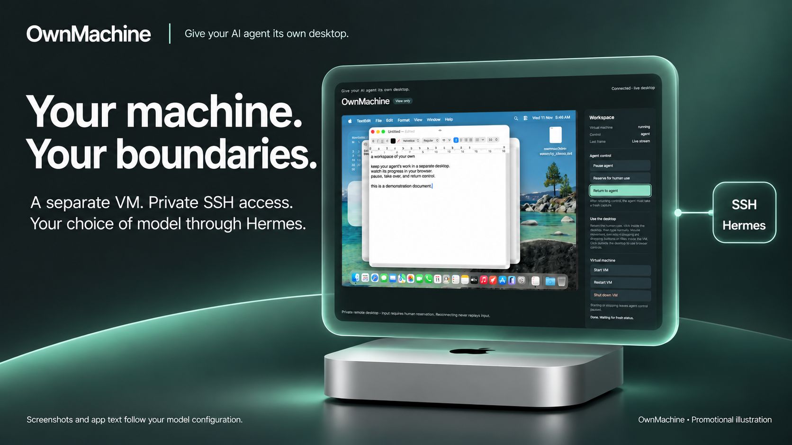
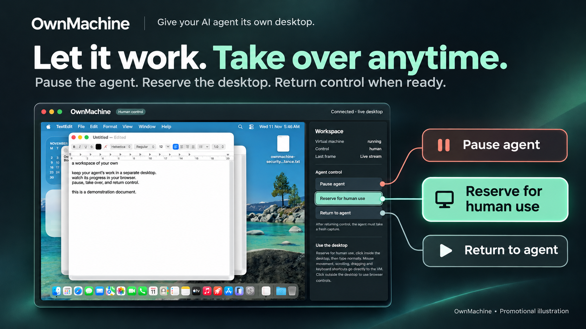
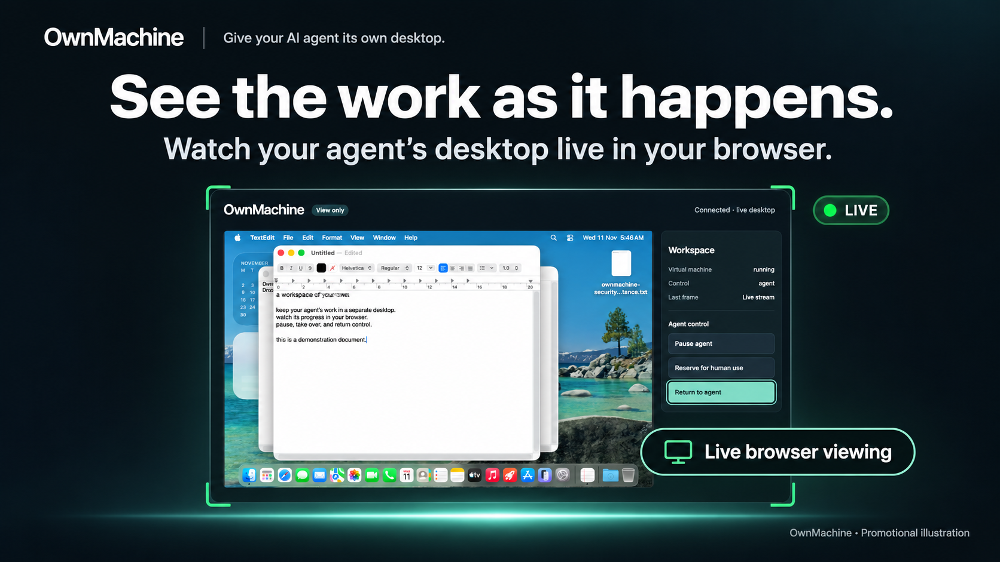
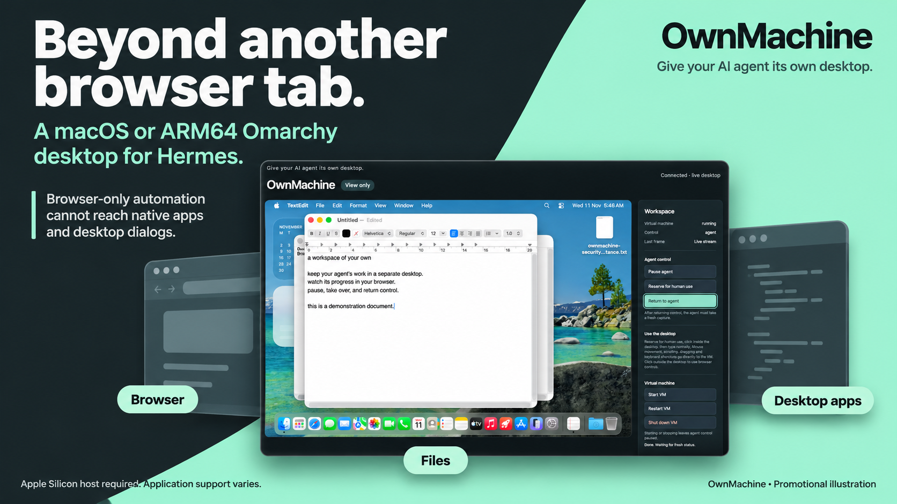

# OwnMachine promotional images

Selected campaign compositions: privacy/model choice, human control, live viewing,
and desktop applications. Generated with codex-imagegen-cli using the project's
public viewer screenshots as visual references. Each image is labelled
“Promotional illustration”; generated UI details are not documentary evidence.
The unchanged screenshots in the parent directory and acceptance reports remain
available as product evidence.

These images accompany the v1.0.1 catalog update but were created after that
release. Catalog image URLs pin this asset commit separately from the immutable
v1.0.1 plugin commit. No release tag or released code is rewritten.

| Image | Message |
| --- | --- |
|  | Your machine. Your boundaries. |
|  | Let it work. Take over anytime. |
|  | See the work as it happens. |
|  | Beyond another browser tab. |

Privacy copy explicitly retains the model-provider boundary: screenshots and app
text follow the user's model configuration. Desktop support is scoped to macOS
and ARM64 Omarchy on an Apple Silicon host, with application support varying.
