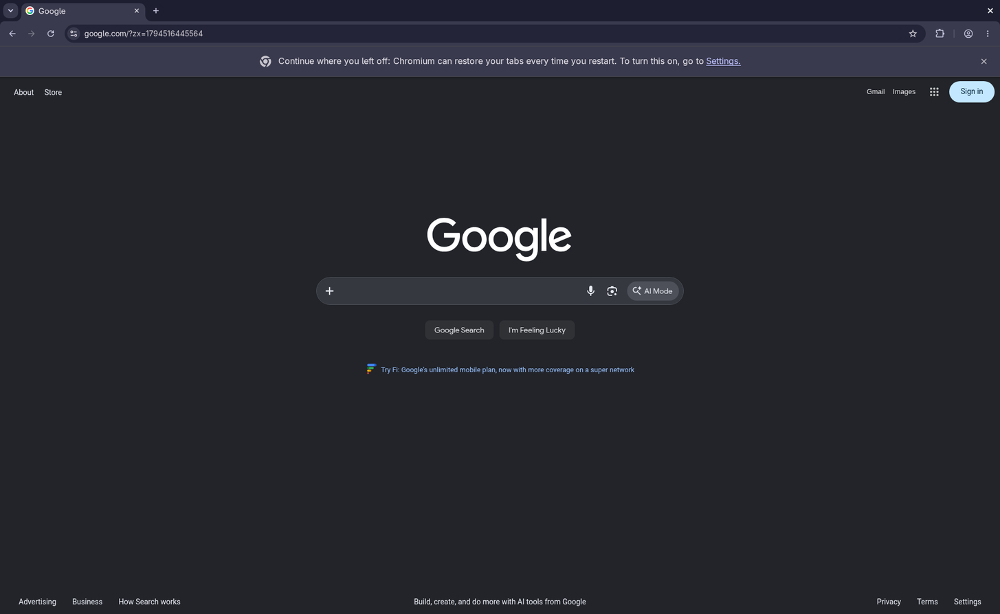

# Final Omarchy security-build acceptance

Verified 2026-11-12 on an Apple Silicon laptop, through a separate Linux Docker
Hermes installation. **Decision: Omarchy foreground desktop support is ready for
PR review for the tested configuration.** This is unreleased PR #15 evidence,
not a merge, release or catalog submission. macOS remains the default.
Background control remains experimental; this is not universal application or
full background-seat support.

## Inputs and separation

- OwnMachine installed through Hermes from immutable GitHub commit
  `e69e554d6d48e6f47738ee7165cdbfd2d19913f0`, including the final security fixes.
- Hermes validation checkout: `b5f15a6d3188e94f815d504d5ebbeb926e1bd08a`.
- Final Linux-capable Lume app: upstream
  `666c196f42dc9c83dbe075e20318f16c3e3a6d84`, common VNC isolation/password-file
  patches and Linux isolation patch. Revision, complete patch inventory, local
  signature and CLI interface verified before deployment. The previous app was
  retained; the configured app path still passed required PF/application-firewall
  readiness without another registration change.
- CuaDriver Linux 0.47.19; archive hash and verified Sigstore identity are in the
  [plan](omarchy-plan.md#security-review-follow-up).
- Fresh rolling-package observations: Hyprland 0.57.2-1, Chromium 156.0.8078.79-1,
  Mousepad 0.7.0-1 and Qt base 6.12.0-4. These are observations, not repository
  freezes. Pending upstream migrations were not applied during acceptance.
- The model was `qwen3.8-flash-next-iq2_xs`, with computer_use and tool discovery;
  terminal, file and code-execution tools were disabled. Foreground native-module
  input was explicitly enabled; background input stayed disabled throughout.

Agent and viewer ran as different Docker UIDs with separate private homes and
SSH keys. Both actual identities passed the documented shared-directory lock and
SQLite transaction checks before startup. The temporary setup key was separate.
The existing laptop guest was stopped and preserved; the new guest used a fresh
empty disk and newly prepared private bootstrap identity. The Mac Studio and
physical host were not rebooted or modified for this run.

The VM used configurable 4 CPUs, 8 GiB RAM, a 64 GiB sparse disk, 1900×1200 display
and scale 1. To preserve the prior guest on a constrained laptop, the operator
explicitly lowered the free-space preflight to 16 GiB; this is **not** a new
recommended minimum. Five-second samples reached about 9.9 GiB of allocated VM
storage during this run. This excludes installer/build caches, preserved guests
and future growth; it does not prove an all-in disk requirement.

## Fresh installation and interruption

After operator source/ISO verification, key/host-key pairing and existing
administrator firewall approval, the installed Hermes plugin ran the entire
post-pairing flow over authenticated SSH:

`preflight → build (verify deployed app) → firewall → provision →
linux-boot-installer → linux-base → linux-boot-system → linux-desktop →
relay → keys → harden → linux-start-desktop → driver → permissions →
viewer-check → verify`.

Installer/base boots kept VNC disabled. An intentional eight-second client
timeout interrupted `linux-base`; the Mac retained its lock and continued.
After restarting only the fresh Docker agent, Hermes imported authenticated
progress and observed the completed checkpoint without repartitioning. Setup then
continued successfully. No manual directory-ownership, keyring, service or guest
configuration repair was needed.

Before hardening, an inspection pause after desktop installation proved that the
root-owned gate existed but no completion receipt did. SDDM refused startup and
remained inactive; guest driver installation refused before installing files.
Resuming the normal guided sequence sealed live policy, started the desktop and
installed the driver successfully. The inspection pause was a negative test,
not a repair or bypass.

Final verification captured a 1456×922 PNG, checked the private viewer and runtime
roles, retired the actual setup key, and proved that key was rejected while runtime
access worked. PNG SHA-256:
`2c0caca08014e484cf4f134e9364727eb8f9012248e08e8e5fc51d9aa4ffa645`.
The agent key refused `vnc`; the viewer key refused `mcp`.

## Real-model tasks and independent checks

### Chromium → Google: passed after explicit first-run handoffs

Hermes launched Chromium and stopped at its Additional Terms. The operator
explicitly authorized acceptance in this fresh guest. First-run keyring prompts
were cancelled through the human-reserved viewer; no empty keyring was created,
no credential was entered and no protection was weakened. One model attempt
could not ground the Cancel action and stopped rather than guessing. After the
operator dismissed those prompts, Chromium remained on New Tab. The operator
did not navigate to Google.

Hermes then used foreground keyboard input to enter `https://www.google.com/`
and navigate. A separate live viewer inspection showed the page and address.
Independent guest inspection found a native Wayland window titled
`Google - Chromium` and a read-only snapshot of this fresh test profile's history
contained the Google URL/title. This is not just a screenshot of a New Tab logo.



### Mousepad save: passed

In the same Hermes conversation, the model discovered/launched native Wayland
Mousepad, typed the sentence and saved through the graphical Save As flow:

```text
OwnMachine Omarchy foreground acceptance passed.
```

Independent SSH inspection found exactly 49 bytes, including the final newline,
and a saved window title without an unsaved asterisk. SHA-256:
`c5314987a6b96f1efbcd1950918ebd884abfc15d6222d22611534d4f8d73b053`.
No operator typed or saved the document. The model corrected a schema/JSON error;
a redundant Save AX action was refused after Enter had already committed the save.
A fresh capture and independent file check established completion.

### Human reservation: passed

With the viewer reserved for human use, Hermes could take a read-only capture.
Its single foreground attempt to type a sentinel returned `human_takeover`,
`dispatched=false` and `operator_review_required=true`. It stopped without a
retry, fallback or control change. The capture showed the original saved text;
the independent saved-file hash remained unchanged after restart.

## Restart and security checks

The viewer's Restart VM control restarted only the saved test guest and left
agent control paused. The document's exact bytes/hash and Chromium history
survived. SDDM and the guest driver became ready again.

The first model capture encountered the closed pre-restart SSH stream and returned
`transport_outcome_unknown`; the model stopped. After independent operator
inspection, an explicitly requested new read-only capture reconnected and returned
a fresh 1456×922 desktop screenshot. No input was replayed. Reconnection is an
explicit read after inspection, not a claim of seamless transparent replay.

Before and after restart:

- Required root firewall readiness and final app verification passed.
- Local authenticated VNC remained available; direct VNC from the separate
  runtime host timed out, demonstrating the external block.
- The guest had no `~/.vnc.env` and no VirtioFS mount.
- Private host password and detached-log files were mode 0600; the VNC password
  was absent from host process arguments. Restart changed its hash.
- Graphical startup passed the hardening receipt/policy gate.

The common patch's macOS normal/recovery paths have the separate Swift regression
coverage in the [security report](omarchy-security-acceptance.md). This fresh
Omarchy run does not claim another newly booted macOS guest test.

## Honest operational boundaries

- First-run Chromium legal/keyring decisions remain human handoffs. This is not
  a fully unattended terms/credential setup promise.
- One active Hermes conversation owns the workspace session. A separate new CLI
  conversation was refused with a session-lock error before dispatch. Resuming
  the original conversation through public `--resume` completed the tasks; no
  lock bypass or guest repair was used.
- Chromium exact-window foreground input needs the explicit ABI-matched Hyprland
  native module. Capture readiness alone does not establish input readiness.
- Earlier bounded GTK background keyboard evidence remains experimental.
  Chromium/Electron background, general Qt keyboard, XWayland, background pointer
  and drag actions, cloud hosts and broad application reliability are not certified.
- Source pins do not freeze rolling packages. Compositor/compiler changes require
  readiness checks and potentially a reviewed module rebuild.
- Temporary model-test approval settings were restored to deny; background input
  remains off and the workspace is left paused. Private logs, identities, runtime
  configuration, bootstrap ISO and VM disks are not release artifacts.

See the [evaluator quickstart](evaluator-quickstart.md#omarchy-foreground-evaluation-unreleased-pr-15)
for portable setup and recovery instructions. Release remains paused for explicit
review and authorization.
