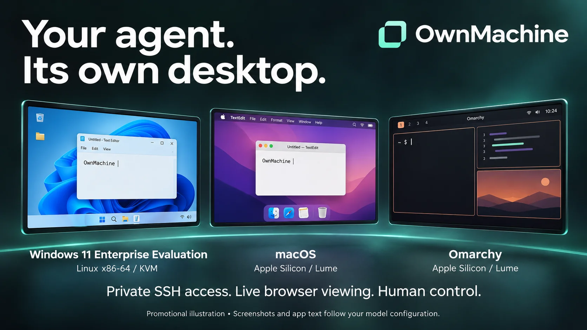

# OwnMachine v1.1.0

Give Hermes its own Windows desktop alongside macOS and Omarchy. This release
adds **Windows 11 Enterprise Evaluation x86-64 on a Linux KVM/libvirt host**, with
persistent files, restricted SSH/MCP control and private browser viewing/input.
macOS and ARM64 Omarchy continue to use Apple Silicon and patched Lume.

## What changes

- Hermes-driven Windows planning, remote preflight, media preparation, staged
  provisioning, authenticated progress, hardening, verification and automatic
  temporary setup-key retirement. Operator handoffs remain explicit.
- Separate agent/viewer SSH identities, per-VM libvirt restrictions, a private Unix
  console, root-owned runtime and persistent firewall with live readiness checks.
- Foreground Notepad save/close/reopen acceptance, corrected filename-control
  handling, capture recovery after session loss, and clear stopped-driver health.
- Correct first-session clock synchronization, visible OpenSSH/bootstrap progress
  that closes itself, a hidden standard-user driver launcher and configurable
  display/sleep policy.
- Explicit installer file modes that work under `umask 077`, plus bounded,
  configurable read-only driver-readiness polling.
- Reviewed maintenance procedures and a clear input/platform support matrix.

## Install and operator handoffs

Start in the [Windows onboarding guide](windows-onboarding.md). Plugin installation
alone does not create a VM. The operator supplies verified Windows evaluation
media and consent, Linux/KVM dependencies, host-key verification, reviewed setup
access and administrator registration. The first DVD boot prompt and later
standard-user sign-in require the private viewer. Windows does not use the macOS
Accessibility/Screen Recording permission flow.

Set the intended Hermes profile's runtime connection, `guest_profile: windows`,
`console_transport: private-unix`, and `computer_use.backend: ownmachine`; use the
same configured control directory for all writers. Keep viewer credentials out of
Hermes. Complete verification and setup-key retirement before routine use.

Existing macOS/Omarchy guests do not need recreation for the Windows addition.
Keep their required patched Lume and firewall protections. Save work and restart
affected Hermes processes after installing the plugin so old provider code is not
retained. See [Windows maintenance and rollback](windows-maintenance.md) for
compatible root-owned relay-code updates. Do not apply Windows registration to an
existing guest or treat code updates as configuration migrations.

## Tested scope and limits

Repeated clean guest installation, first-session time, real-model file
save/close/reopen with independent content verification, idle capture and guest
cold-start persistence passed. Lock/unlock, sign-out/in, driver/gateway restart,
mixed-profile refusal, fresh registration under umask 077 and live compatible
relay-code upgrade/rollback were also exercised. The
[acceptance report](windows-kvm-acceptance.md) distinguishes operator-reported runs,
direct installed-Hermes backend checks and isolated tests.

- Home/Pro, Windows ARM, other hypervisors and cloud hosts are not qualified.
- Physical Linux-host reboot acceptance was explicitly skipped. Firewall-service
  restart is tested but does not prove complete host-reboot recovery.
- General background input, broad pixel/drag/scroll coverage, clipboard sync and
  privileged-desktop automation are outside the Windows support claim. Follow
  the [input matrix](windows-support-matrix.md), including explicit foreground
  delivery for the tested Notepad workflow and refusal of unsupported filename
  `set_value` operations. Never replay uncertain input or silently escalate modes.
- The driver remains pinned. There is no supported in-place guest-driver updater
  after setup-key retirement; qualify a separate fresh guest for a new pin.
- Host-crash recovery during disk mutations and arbitrary partial-registration
  repair are not automatic. Preserve checkpoints and inspect uncertain outcomes.

The new artwork is promotional illustration, not synthetic evidence of a model
run. Desktop screenshots and application text follow the user's configured model
provider. PolyForm Noncommercial 1.0.0 remains the license.
