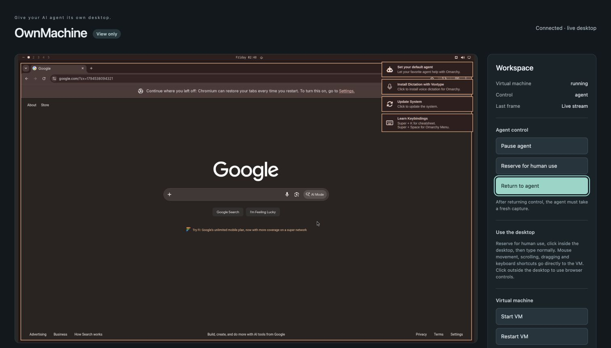

# Security and rolling-update acceptance

2026-11-12; maintenance implementation `73a1a61394fe095cd90b32f7f55ccbbcf55ea44a`.

The updated Linux Lume build was deployed and relay cold-started. Default text/
JSON listings and startup logs contained no VNC password; private relay discovery
still worked. Password/log permissions and argv checks passed. Common/macOS and
Linux build paths and Swift printer regressions passed; this update was not
redeployed on the separate macOS test host.

Required firewall checks passed and direct LAN VNC was blocked. An initial app
identity collision refused startup until registration was corrected. The listener
still binds all interfaces: PF and the application firewall remain mandatory.
Optional guest-bridge SSH filtering blocked new guest-to-host SSH connections while
preserving authorized LAN SSH, including after guest restart. Other host services
are outside that rule. Two confirmed-empty legacy directories were removed safely.

## Rolling update and real-model retest

The updater initially failed on missing signed repository/prerequisites. Operator
repair used the official signed ARM package route; no signature bypass or migration
skip was used. Pending migrations reached zero and stayed zero after restart.
Hardening, driver readiness, saved data and native input compatibility passed.
This is one tested rolling update, not a guarantee of future compatibility.

Hermes navigated Chromium to Google after an operator canceled an optional keyring
prompt. Independent viewer, native-window and browser-history checks confirmed
completion. The operator did not navigate, create a keyring or weaken its password
store. This was an assisted prompt handoff, not a fully unattended pass.

Agent control was paused and test approvals restored afterward. See the
[operator guide](linux-development.md) and [security requirements](../SECURITY.md).

This is a scoped historical result, not certification of every later commit.
See the [acceptance overview](acceptance.md) for current evidence and limits.
