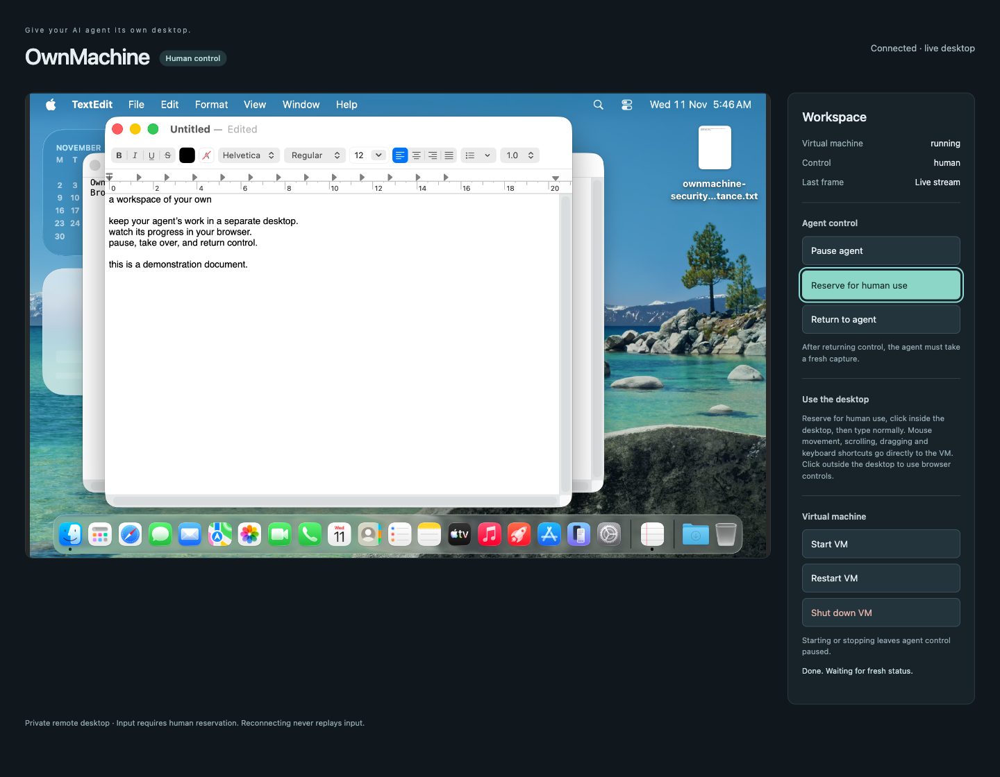
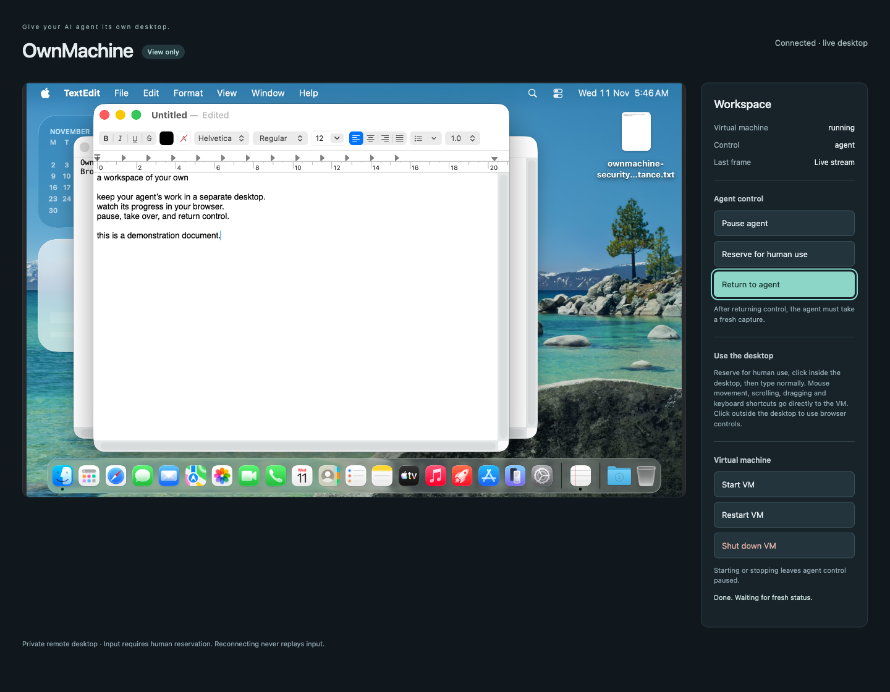

# OwnMachine

**Give your AI agent its own desktop.**

OwnMachine connects Hermes to a persistent, separate macOS VM through restricted
SSH and MCP. The agent works in its own guest desktop; a separately installed
private browser viewer lets you watch, pause it, reserve the workspace for human
mouse/keyboard input, and return control. Your personal host desktop is not the
computer-use target.

This is a preview, not an approved Hermes catalog listing. It requires Hermes
0.23.1 or later (release testing on 0.23.1; current-upstream validation
is recorded in the catalog readiness report), OpenSSH, and a compatible Apple Silicon Mac
running the Lume guest. Hermes may run on another machine; a Linux Docker runtime
has been tested. Cloud Mac hosting has not been acceptance-tested.

## Guided setup commands

Start with `/ownmachine setup` in Hermes chat. Hermes default plugin-host mode
skips plugin CLI commands and cannot load the native provider. In a dedicated
OwnMachine profile, explicitly run `hermes config set plugins.isolation in_process`
before using `hermes ownmachine setup` or `hermes ownmachine doctor` in a terminal.
This is a profile isolation choice, not something setup silently changes. The terminal wizard asks for a local Mac, remote Mac or existing relay,
then previews non-secret settings. It saves only when you choose to. Chat and
noninteractive sessions never wait for stdin.

```sh
hermes ownmachine setup --target remote --vm-name ownmachine --save
hermes ownmachine setup --json
hermes ownmachine doctor
```

For an already prepared relay, use your own verified SSH alias and absolute
shared control path:

```sh
hermes ownmachine setup --target existing --host-alias example-mac \
  --control-dir /absolute/shared/control --connect
```

The same options work after `/ownmachine setup` in chat. `--connect` saves the
connection in the active profile; it requires `--replace` if different connection
settings already exist. It does not select the native provider or change Hermes
isolation/toolsets: follow the dedicated-profile setup below and start a new
session after configuration changes. `hermes ownmachine doctor --json` and
`/ownmachine doctor` report bounded read-only readiness.

This first onboarding phase provides planning, resume, connection configuration
and diagnosis. **Fresh account/VM/firewall/viewer installation remains a guided
operator workflow**, not an action performed by these commands. Setup stores
non-secret choices in the active profile's `setup_plan`; never put passwords,
private keys or viewer tokens in it or in chat. Resource choices and storage
budgets are configurable; remote capacity is not inferred from the local machine.

## Browser viewer and handoff

Actual browser captures from the dedicated acceptance guest, using demonstration
text. The viewer is a separate operator service, not a Hermes Desktop extension.





## Install and configure

Installing this package alone does **not** provision a VM, install the driver or
viewer, open network ports, or grant macOS permissions. Obtain the full source
from the [release page](https://github.com/rbur0425/ownmachine/releases) and follow:

1. [Host SSH and restricted relay setup](https://github.com/rbur0425/ownmachine/blob/v0.6.0/docs/host-setup.md).
2. [Guest provisioning and permissions](https://github.com/rbur0425/ownmachine/blob/v0.6.0/docs/vm-setup.md)
   and [native provider / MCP setup](https://github.com/rbur0425/ownmachine/blob/v0.6.0/docs/native-provider.md).
3. [Hermes home configuration and viewer onboarding](https://github.com/rbur0425/ownmachine/blob/v0.6.0/docs/community-setup.md).
4. [Persistent startup](https://github.com/rbur0425/ownmachine/blob/v0.6.0/docs/permanent-installation.md)
   and [private viewer access](https://github.com/rbur0425/ownmachine/blob/v0.6.0/docs/viewer-access.md).

Set `plugins.entries.ownmachine.settings.host_alias` to your verified SSH alias,
`vm_name` to the relay's configured guest, and `control_dir` to an absolute private
state directory. Every agent and viewer for that VM must share the same underlying
control directory, including across container mounts. Follow the native-provider
guide to select `ownmachine` as the computer-use backend. The tested integration
requires in-process plugin loading; use a dedicated Hermes home if another plugin
requires a different isolation setting. Standard permissions remain enabled.

Run `hermes computer-use doctor` in that home. It checks readiness without sending
GUI input, resetting uncertain actions or approving permissions. The full source
also supplies operator-only provisioning, lifecycle and recovery commands.

## Registered capabilities

- `ownmachine_status`: bounded, read-only host/guest readiness and shared-control
  status. It does not create guests or grant permissions.
- Native `ownmachine` computer-use provider: desktop/window capture, accessibility
  inspection and supported guest input through Hermes's public provider API.
- `tool_execution` middleware: reports shared-control gate outcomes.
- No additional hooks, model credentials, OAuth clients or required environment
  secrets are registered by this package.

The agent does not receive viewer-access tokens or control-transfer tools. Failed
or uncertain writes block follow-up writes for operator review; they are not
replayed. A takeover waits for active input and cannot recall an event already sent.

## Installation and security disclosures

The updated source requires [separate agent/viewer identities and firewall
verification](https://github.com/rbur0425/ownmachine/blob/v0.6.0/docs/security-isolation.md).
Hardened VNC requires the pinned local Lume build with protected-file password
input (Xcode/Swift required); the upstream binary exposes argv passwords to other
local accounts. No forked binary is bundled. The v0.6.0 preview includes
this hardening. Fresh dedicated Hermes profiles
disable terminal, file and code-execution toolsets.

**Plugin runtime:** the provider launches an OpenSSH subprocess and maintains a
stdio MCP session through the configured Mac relay to the guest driver. The relay
accepts only supported operations for its configured VM. This is not a required
reverse SSH tunnel. OpenSSH uses the runtime account's SSH configuration, verified
known-hosts file and restricted key or SSH agent; OwnMachine does not parse private
keys or read Hermes/vendor credential stores. This operator-managed authentication
is disclosed under the catalog credential policy. On 2026-11-11 the owner
confirmed that this design and the PolyForm license are acceptable for submission.
That confirmation and the passing scanner are not catalog admission.
No secret is declared in `requires_env` or `config_schema`; if future functionality
needs one, it must use the applicable Hermes secret-scope or credentialed-request
API, not direct environment or credential-file reads. The subprocess receives only PATH, HOME, SSH_AUTH_SOCK and LANG from its
environment.

**State and access outside this package:** the plugin reads/writes its configured
shared-control database and reads the viewer heartbeat there. Captures and app text
flow to Hermes, which may send them to your configured model provider. Guest apps
can access their configured network services. Self-hosting the VM does not make
cloud-model requests local or hide them from that provider.

**Separate operator setup:** scripts outside `plugin/` download Lume 0.7.0 and
CuaDriver 0.44.0 from official `trycua/cua` GitHub releases, verify pinned SHA-256
checksums and Apple code-signing identities, and provision a macOS guest using
Apple restore media. No executable binary is bundled in this plugin. The host
firewall installer and guest hardening require explicit administrator commands;
Accessibility, Screen Recording and final capture consent require human approval
inside the guest. Setup retains private SSH material, a guest password and runtime
configuration in operator-owned files. Lume and driver telemetry are disabled by
the supplied setup; this plugin adds no telemetry.

**Separate viewer:** a long-running Python/noVNC service streams the guest desktop.
Its HTTP listener binds loopback, uses a private access token/session cookie and
requires human reservation for input. SSH carries the VNC traffic; the configured
host firewall must block direct network access to Lume's VNC port. The viewer
stores its bearer access link and control state outside this package. Do not expose
the viewer or VNC directly to the internet. Its dependencies and notices are in
[viewer provenance](https://github.com/rbur0425/ownmachine/blob/v0.6.0/viewer/VENDOR.md).

**Updates:** no self-updater is registered or run by this package. Catalog installs
must follow reviewed catalog SHA updates through Hermes. Standalone installation
and offline upgrade scripts belong to the full-source operator workflow, not the
catalog-installed subdirectory.

Read the [security model](https://github.com/rbur0425/ownmachine/blob/v0.6.0/SECURITY.md)
and [recovery guide](https://github.com/rbur0425/ownmachine/blob/v0.6.0/docs/recovery.md).

## Password-manager policy

OwnMachine does not register `browser_vault`, `ctx.register_login_backend`, an
OAuth client, or a password-manager integration. It requests the `community` tier,
not `verified` or `official`. Guest/VNC provisioning passwords belong to the
separate operator setup; they are not a browser login backend. This distinction
does not remove OpenSSH authentication from the credential-policy disclosure.
The owner has confirmed license and SSH eligibility; upstream review is still
required.

## Tested behavior and preview limits

Clean guest setup, a real-model Accessibility document task with independent
verification, live browser input/handoff, persistence and operator-assisted host
reboot recovery have been tested in the scopes recorded below. The new security
account/firewall arrangement has not had physical-host reboot acceptance or an
independent application-firewall-only random-port check. An initial guest hang
required a power-off; later normal lifecycle checks passed. Screenshot/pixel-click model acceptance is
deferred after a capture-expiry failure. There is no claim of reliable control
across every app or model. Guest backup/restore, unattended host unlock/startup,
cloud Mac acceptance and native-viewer password-dialog paste remain outside the
verified scope. See [acceptance evidence](https://github.com/rbur0425/ownmachine/blob/v0.6.0/docs/release-readiness.md).

## License

The [PolyForm Noncommercial License 1.0.0](LICENSE) permits use, modification
and redistribution for its permitted noncommercial purposes, subject to its
terms and notice requirements. It also expressly permits use by the organizations
listed in its Noncommercial Organizations section. Commercial use outside those
permissions requires a separate license from [Roland Burke](https://github.com/rbur0425).

OwnMachine is source-available, not open source. Third-party components retain
their own terms. Earlier valid license grants are not revoked. See
[licensing details](https://github.com/rbur0425/ownmachine/blob/develop/docs/licensing.md).

The owner has confirmed license and SSH eligibility for submission. OwnMachine
has not been submitted to or admitted by the Hermes catalog.
